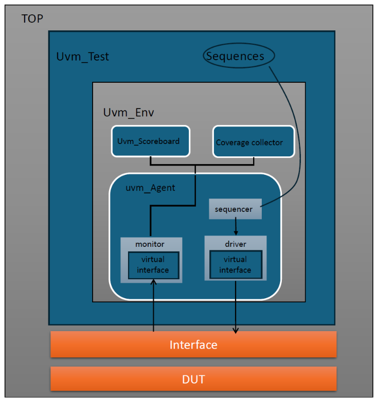
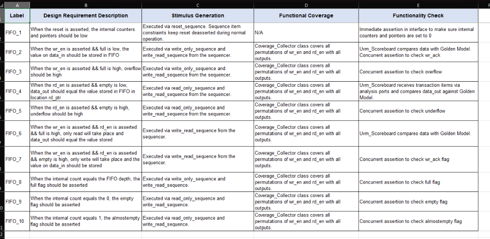
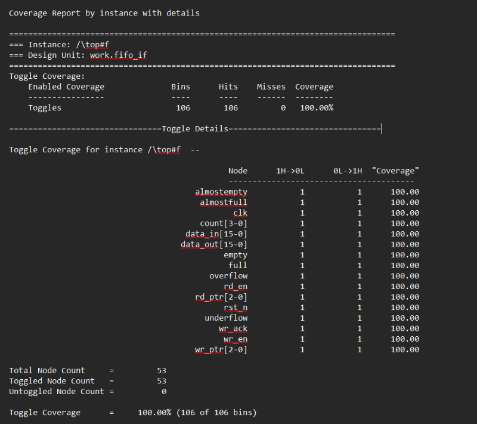
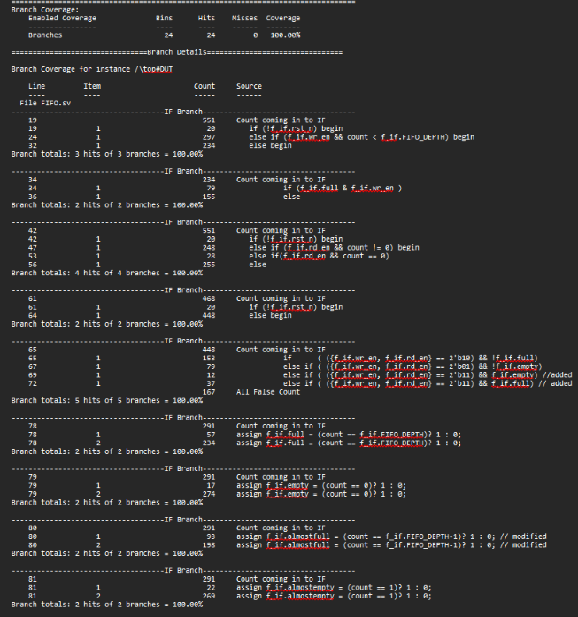
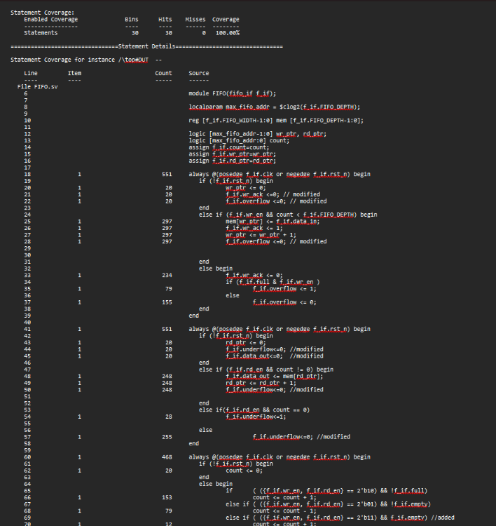
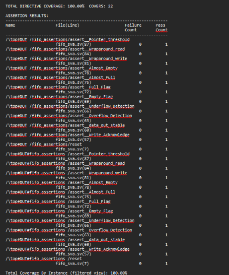
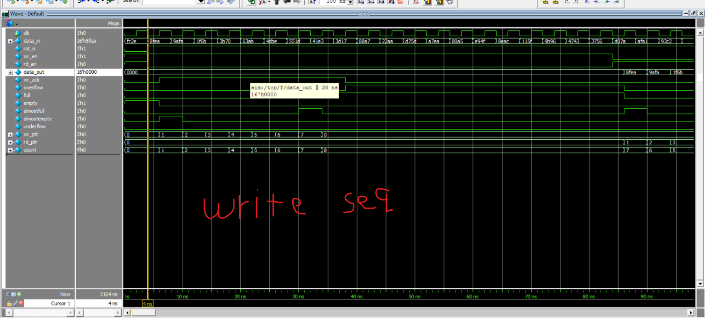
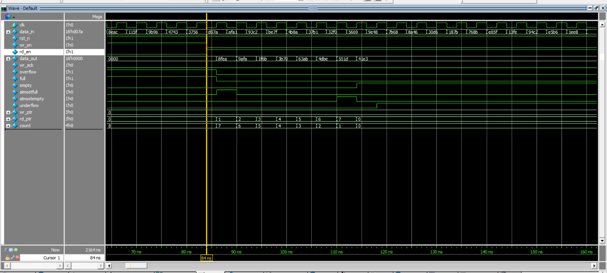
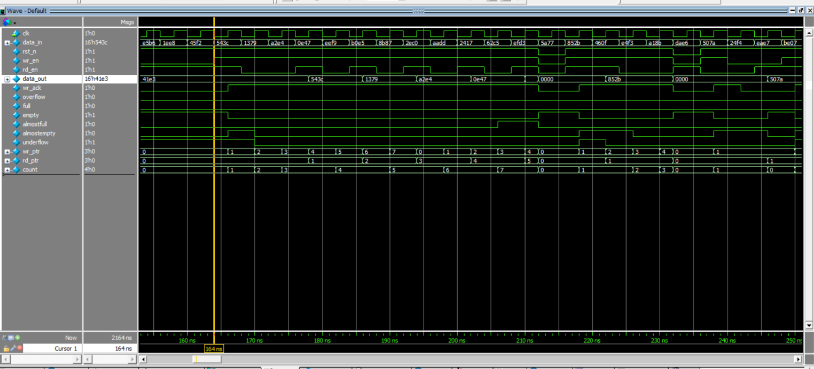

# UVM FIFO Verification


A complete, constrained-random **UVM verification environment** for a synchronous FIFO (depth 8, width 16). The project includes a layered testbench, a golden-model scoreboard, SystemVerilog Assertions (SVA), functional and code coverage, and a written verification plan. The environment found and helped fix three bugs in the original RTL.

<p align="center">
  
</p>

---

## Table of Contents

1. [Design Under Test](#design-under-test)
2. [Testbench Architecture](#testbench-architecture)
3. [Sequences and Test Flow](#sequences-and-test-flow)
4. [Assertions (SVA)](#assertions-sva)
5. [Functional Coverage](#functional-coverage)
6. [Verification Plan](#verification-plan)
7. [Bugs Found in the RTL](#bugs-found-in-the-rtl)
8. [Results](#results)
9. [Waveforms](#waveforms)
10. [Repository Structure](#repository-structure)
11. [How to Run](#how-to-run)
12. [Credits](#credits)

---

## Design Under Test

A synchronous FIFO with configurable depth and width (set in `fifo_if`):

| Parameter | Value |
|-----------|-------|
| `FIFO_WIDTH` | 16 |
| `FIFO_DEPTH` | 8 |

| Signal | Direction | Description |
|--------|-----------|-------------|
| `clk` | in | Clock (4 ns period in `top.sv`) |
| `rst_n` | in | Active-low asynchronous reset |
| `wr_en`, `rd_en` | in | Write / read request |
| `data_in` | in | Write data |
| `data_out` | out | Read data |
| `wr_ack` | out | Write acknowledge |
| `overflow` | out | Write attempted while full |
| `underflow` | out | Read attempted while empty |
| `full`, `empty` | out | Occupancy flags |
| `almostfull` | out | High when `count == FIFO_DEPTH-1` |
| `almostempty` | out | High when `count == 1` |
| `count`, `wr_ptr`, `rd_ptr` | out | Internal counters exposed through the interface for checking |

---

## Testbench Architecture

`top` instantiates the DUT and the physical interface, binds the assertion module to the DUT, stores the virtual interface in `uvm_config_db`, and calls `run_test("fifo_test")`.

| Component | File | Role |
|-----------|------|------|
| **Test** | `fifo_test.sv` | Builds the environment, runs the reset, write-only, read-only and write/read sequences |
| **Environment** | `fifo_env.sv` | Contains the agent, scoreboard and coverage collector, and connects the analysis ports |
| **Config** | `fifo_config.sv` | Carries the virtual interface to the agent through `uvm_config_db` |
| **Agent** | `fifo_agent.sv` | Groups sequencer, driver and monitor |
| **Sequencer** | `fifo_sqr.sv` | Standard sequencer for `Myseq_item` |
| **Driver** | `fifo_driver.sv` | Converts transactions into pin-level activity on the interface |
| **Monitor** | `fifo_mon.sv` | Samples the interface and broadcasts transactions through an analysis port |
| **Scoreboard** | `fifo_sb.sv` | Golden reference model, compares DUT `data_out` with the expected value, reports pass/fail counts |
| **Coverage** | `fifo_coverage.sv` | Covergroup with coverpoints and crosses over the control inputs and status flags |
| **Sequence item** | `fifo_seq_item.sv` | Randomized transaction (`rst_n`, `wr_en`, `rd_en`, `data_in`) plus observed outputs |
| **Assertions** | `fifo_sva.sv` | Concurrent assertions and cover properties, bound to the DUT |

---

## Sequences and Test Flow

| Sequence | File | Transactions | Purpose |
|----------|------|--------------|---------|
| `rst_seq` | `rst_seq.sv` | Reset | Apply and release reset |
| `write_only_seq` | `write_only_seq.sv` | 20 | `wr_en=1`, `rd_en=0`: fill the FIFO, reach full, overflow |
| `read_only_seq` | `read_only_seq.sv` | 20 | `wr_en=0`, `rd_en=1`: drain the FIFO, reach empty, underflow |
| `write_read_seq` | `write_read_seq.sv` | 500 | Random mix: `wr_en` 70% high, `rd_en` 50% high, covers simultaneous read/write |

The sequence item constrains `rst_n` to stay deasserted most of the time (98:2 distribution) so reset is also exercised in the middle of random traffic.

Test order: **reset, write-only, read-only, write/read**.

---

## Assertions (SVA)

All properties have both an `assert` and a `cover` directive. They are compiled only when `+define+SIM` is passed.

| Check | Property |
|-------|----------|
| Reset values | `always_comb` + `assert final`: counters, pointers and flags return to reset values |
| Write acknowledge | `wr_en && !full` `\|=>` `wr_ack` |
| Overflow | `wr_en && full && !rd_en` `\|=>` `overflow` |
| Underflow | `rd_en && empty && !wr_en` `\|=>` `underflow` |
| Data stability | `!(rd_en && !empty)` `\|=>` `$stable(data_out)` |
| Empty flag | `count == 0` `\|->` `empty` |
| Full flag | `count == FIFO_DEPTH` `\|->` `full` |
| Almost full | `count == FIFO_DEPTH-1` `\|->` `almostfull` |
| Almost empty | `count == 1` `\|->` `almostempty` |
| Write pointer wrap | `wr_ptr == FIFO_DEPTH-1 && wr_en && !full` `\|=>` `!wr_ptr` |
| Read pointer wrap | `rd_ptr == FIFO_DEPTH-1 && rd_en && !empty` `\|=>` `!rd_ptr` |
| Legal limits | pointers `< FIFO_DEPTH` and `count <= FIFO_DEPTH` |

---

## Functional Coverage

The covergroup in `fifo_coverage.sv` samples every monitored transaction and crosses `wr_en` and `rd_en` with each status output:

- `full`, `almostfull`, `empty`, `almostempty`
- `overflow`, `underflow`, `wr_ack`

Illegal or unreachable combinations (for example `overflow` with `wr_en = 0`) are excluded with `ignore_bins`.

---

## Verification Plan

| Label | Requirement | Stimulus | Check |
|-------|-------------|----------|-------|
| FIFO_1 | Reset clears counters and pointers | Reset sequence | Immediate assertion in the interface/SVA |
| FIFO_2 | Write while not full stores `data_in` | Write-only and write/read sequences | Scoreboard vs. golden model, `wr_ack` assertion |
| FIFO_3 | Write while full raises `overflow` | Write-only and write/read sequences | Overflow assertion |
| FIFO_4 | Read while not empty outputs stored data | Read-only and write/read sequences | Scoreboard vs. golden model |
| FIFO_5 | Read while empty raises `underflow` | Read-only and write/read sequences | Underflow assertion |
| FIFO_6 | Read and write together while full: only read happens | Write/read sequence | Scoreboard vs. golden model |
| FIFO_7 | Read and write together while empty: only write happens | Write/read sequence | `wr_ack` assertion |
| FIFO_8 | `count == FIFO_DEPTH` asserts `full` | Write-only and write/read sequences | Full-flag assertion |
| FIFO_9 | `count == 0` asserts `empty` | Read-only and write/read sequences | Empty-flag assertion |
| FIFO_10 | `count == 1` asserts `almostempty` | Read-only and write/read sequences | Almost-empty assertion |

<details>
<summary>Verification plan (original sheet)</summary>



</details>

---

## Bugs Found in the RTL

1. **`underflow` was sequential instead of combinational**: it was registered, so it did not follow the read-on-empty condition as specified.
2. **`almostfull` threshold was wrong**: it must be high when `count == FIFO_DEPTH-1` (not a width-based value).
3. **`data_out` was not cleared on reset**: it must be `0` while reset is asserted.

Fixed lines are marked with `// modified` in `rtl/FIFO.sv`.

---

## Results

| Metric | Result |
|--------|--------|
| Toggle coverage | **100%** (106 / 106 bins) |
| Branch coverage | **100%** (24 / 24 branches) |
| Statement coverage | **100%** (30 / 30 statements) |
| Assertion / cover directives | **100%**, 0 failures (22 covers) |

The full text report is in [`reports/coverage_rpt_fifo.txt`](reports/coverage_rpt_fifo.txt).

<table>
  <tr>
    <td align="center"><b>Toggle</b><br></td>
    <td align="center"><b>Branch</b><br></td>
  </tr>
  <tr>
    <td align="center"><b>Statement</b><br></td>
    <td align="center"><b>Assertions</b><br></td>
  </tr>
</table>

---

## Waveforms

**Write-only sequence**: the driver asserts `wr_en=1`, `rd_en=0` with random `data_in`. `wr_ptr` and `count` increase and `wr_ack` is raised.



**Read-only sequence**: the driver asserts `rd_en=1`, `wr_en=0`. Data appears on `data_out`, `rd_ptr` increases and `count` decreases.



**Write/read sequence**: random `wr_en` and `rd_en`, including simultaneous operations.



---

## Repository Structure

```
UVM_FIFO/
├── rtl/
│   ├── FIFO.sv               # DUT
│   └── fifo_if.sv            # Interface
├── sva/
│   └── fifo_sva.sv           # Assertions (bound to the DUT)
├── tb/
│   ├── fifo_seq_item.sv
│   ├── fifo_config.sv
│   ├── fifo_sqr.sv
│   ├── fifo_driver.sv
│   ├── fifo_mon.sv
│   ├── fifo_agent.sv
│   ├── fifo_sb.sv
│   ├── fifo_coverage.sv
│   ├── fifo_env.sv
│   ├── rst_seq.sv
│   ├── write_only_seq.sv
│   ├── read_only_seq.sv
│   ├── write_read_seq.sv
│   ├── fifo_test.sv
│   └── top.sv
├── sim/
│   ├── run.do                # Compile, simulate, save and report coverage
│   └── src_files.f           # Ordered compile list
├── reports/
│   └── coverage_rpt_fifo.txt
├── docs/
│   ├── Abdelrahman_Mohamed_Eid_UVM_FIFO.pdf
│   └── images/
└── README.md
```

---

## How to Run

**Requirements:** QuestaSim / ModelSim with UVM support.

From a terminal:

```bash
cd sim
vsim -do run.do
```

Or from inside the QuestaSim console, one command per line:

```tcl
cd sim
do run.do
```

`run.do` compiles the RTL with coverage enabled, compiles the testbench with `+define+SIM` (enables the assertions), runs the simulation, saves `fifo.ucdb`, and writes the coverage report to `reports/coverage_rpt_fifo.txt`.

> Run from inside `sim/`: the paths in `run.do` and `src_files.f` are relative (`../rtl`, `../tb`, `../sva`).

---

## Credits

- **Testbench, assertions, coverage and verification plan:** Abdelrahman Mohamed Eid
- **Original RTL:** Eng. Kareem Waseem, course *Digital Verification using SV & UVM*
